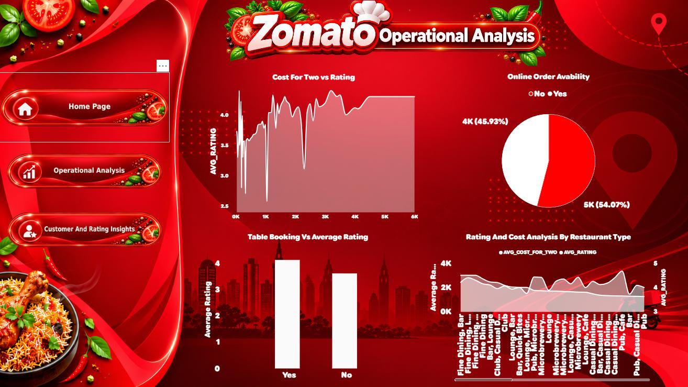

# Zomato Restaurant Analysis

This powerbi report shows the analysis of restaurants of the Bengaluru City.

  

### 🏠 Home Page / Overview Dashboard
The main overview page provides a high-level executive summary of the Zomato restaurant ecosystem, featuring core metrics and geographic filters.

* **Key Performance Indicators (KPIs):** 
  * **Total Restaurants:** 8,712 evaluated locations.
  * **Total Votes:** 13.31M customer ratings and feedback entries.
  * **Online Order %:** 58.94% of restaurants support online ordering.
  * **Book Table %:** 12.04% of locations offer table reservation capabilities.
* **Interactive Filters:** City-based filtering options (including Banashankari, Bannerghatta Road, Basavanagudi, Bellandur, Brigade Road, and Brookefield).
* **Visual Breakdown:** Includes comparative charts on table booking percentages and the overall distribution curve of restaurant ratings.

  

### ⚙️ Operational Analysis Dashboard
This section breaks down business logistics, pricing trends, online availability, and restaurant category performance.

* **Cost For Two vs Rating:** Line graph analyzing how pricing tiers correlate with average restaurant ratings.
* **Online Order Availability:** Donut chart showing that 54.07% (5K) of establishments offer online ordering, while 45.93% (4K) do not.
* **Table Booking vs Average Rating:** Bar chart comparing average ratings against table reservation availability (Yes vs No).
* **Rating And Cost Analysis By Restaurant Type:** Detailed dual-axis breakdown evaluating average cost and average ratings across various restaurant formats (such as Fine Dining, Bar, Casual Dining, Pub, and Café combinations).