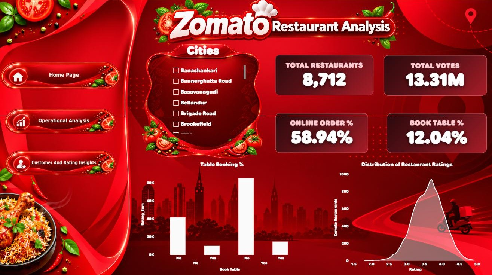

# Zomato Restaurant Analysis

This powerbi report shows the analysis of restaurants of the Bengaluru City.

  

### 🏠 Home Page / Overview Dashboard
The main overview page provides a high-level executive summary of the Zomato restaurant ecosystem, featuring core metrics and geographic filters.

* **Key Performance Indicators (KPIs):** 
  * **Total Restaurants:** 8,712 evaluated locations[cite: 6].
  * **Total Votes:** 13.31M customer ratings and feedback entries[cite: 6].
  * **Online Order %:** 58.94% of restaurants support online ordering[cite: 6].
  * **Book Table %:** 12.04% of locations offer table reservation capabilities[cite: 6].
* **Interactive Filters:** City-based filtering options (including Banashankari, Bannerghatta Road, Basavanagudi, Bellandur, Brigade Road, and Brookefield)[cite: 6].
* **Visual Breakdown:** Includes comparative charts on table booking percentages and the overall distribution curve of restaurant ratings[cite: 6].